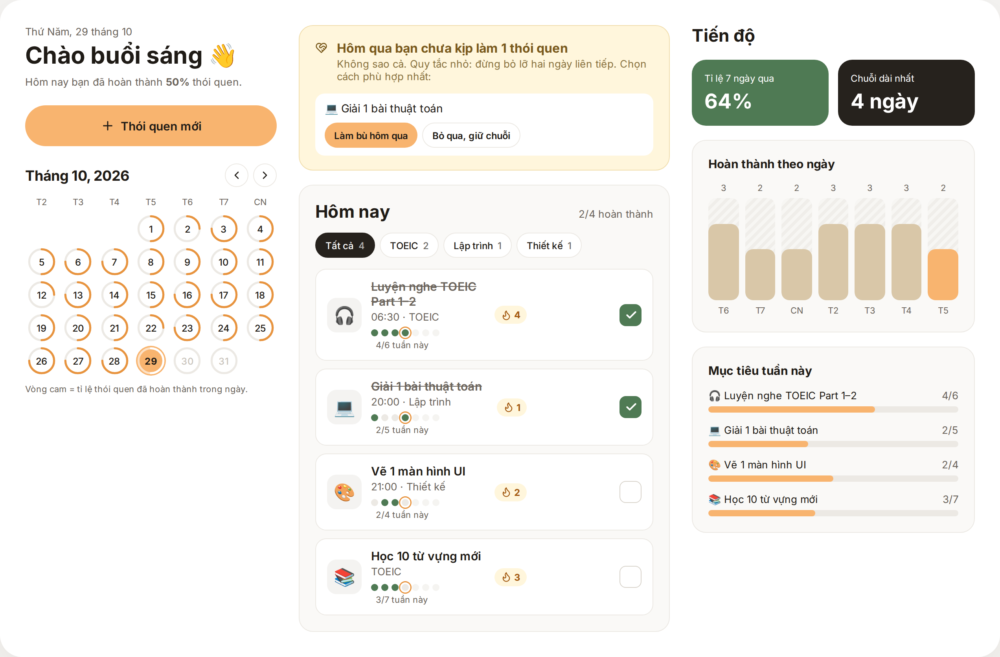
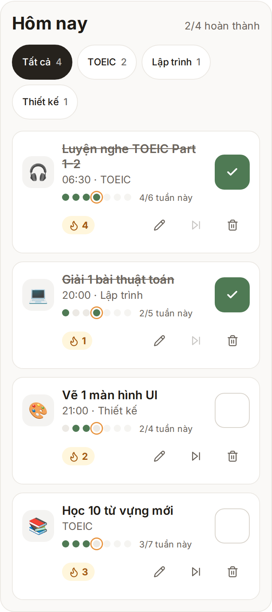

# Habit Tracker — Study Planner

React 18 + TypeScript + Vite. Không cần backend; dữ liệu lưu ở `localStorage`.

## Cách chạy dự án

```bash
npm install
npm run dev
```

## Giao diện





> Demo: *Dán link Vercel vào đây sau khi deploy.*

## Tính năng

- **CRUD thói quen**: tạo, sửa, xóa (có xác nhận) — `HabitForm`, `App`
- **Form validation**: tên 2–40 ký tự, không trùng, giờ hợp lệ, mục tiêu 1–7 — `lib/habits.ts#validate`
- **Lịch tháng** với vòng tiến độ từng ngày, chọn ngày cũ để làm bù — `Calendar`
- **Biểu đồ**: cột 7 ngày gần nhất + thanh mục tiêu tuần (SVG/CSS thuần, không thư viện) — `Analytics`
- **Xử lý bỏ lỡ**: banner “hôm qua bạn chưa làm” → *Làm bù* hoặc *Bỏ qua, giữ chuỗi* — `MissedBanner`, `streak()`
- **localStorage**: hook `useLocalStorage` có try/catch, dữ liệu mẫu ở lần đầu mở
- **Lọc theo lĩnh vực** (TOEIC / Lập trình / Thiết kế) và **dải 7 chấm** thể hiện nhịp độ tuần ngay trên từng thói quen
- **Hoàn tác** khi xóa / đặt lại dữ liệu (thay cho hộp xác nhận)
- **Accessibility**: checkbox đúng role, `aria-*`, dialog đóng bằng Esc, tôn trọng `prefers-reduced-motion`

## Cấu trúc

`src/lib` logic thuần (dễ viết test) · `src/hooks` · `src/components` · `src/styles.css`

## Việc nên làm tiếp

Viết vài unit test cho `streak`, `missedYesterday`, `validate` (Vitest) · deploy Vercel · chụp ảnh/GIF cho README.
